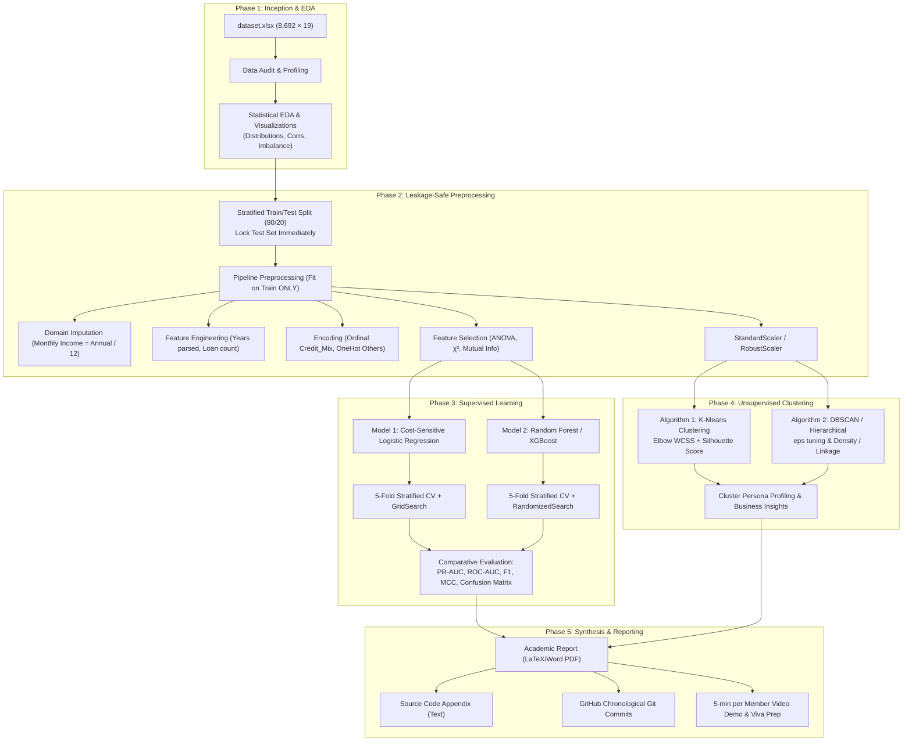
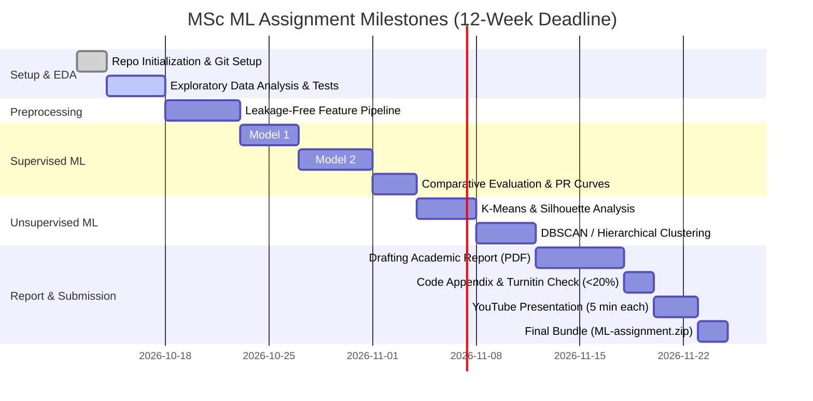

# MSc Programming Assignment Implementation Plan
## IT5022 — Fundamentals of Machine Learning (40 Marks)
### Project Title: Real-World Credit Risk Scoring & Customer Financial Segmentation

---

## 1. Executive Summary & Assessment Overview

This implementation plan is specifically tailored to achieve **Distinction / Grade A (8–10 Band)** on the MSc IT5022 Programming Assignment based on the official course marking rubric and lecture syllabus.

### Project Scope & Constraints
* **Team Size:** 2 Members (Clear individual contributions tracked via Git).
* **Dataset:** Real-world credit risk dataset (`dataset.xlsx`: 8,692 rows, 19 features, target: `Credit_Score`).
* **Required Algorithms (per assignment brief):**
  * **Supervised Learning (2 distinct algorithms):**
    1. *Algorithm 1 (Parametric / Linear baseline):* Regularized Logistic Regression (with threshold tuning and cost-sensitive weighting).
    2. *Algorithm 2 (Non-linear Ensemble):* Random Forest Classifier / XGBoost (with hyperparameter optimization and feature importance analysis).
  * **Unsupervised Learning (2 distinct algorithms):**
    1. *Algorithm 1 (Partition-based):* K-Means Clustering (with Elbow method, Silhouette analysis, and cluster profiling).
    2. *Algorithm 2 (Density / Hierarchical):* DBSCAN or Agglomerative Hierarchical Clustering (with dendrogram interpretation and noise outlier identification).
  * *Constraint:* Non-Deep Learning models only (Strictly enforced).
* **Deliverables:**
  1. `members.txt` (Student IDs & emails).
  2. `submission.txt` (Dataset link, public GitHub repository, YouTube demo link).
  3. Public GitHub Repository with comprehensive, chronological commit history.
  4. Fully documented, reproducible Jupyter Notebooks (`notebooks/`).
  5. Academic Report (PDF) with full source code in text appendix (< 20% Turnitin similarity).
  6. 5-minute video demonstration per member + Viva voce readiness.

---

## 2. End-to-End Implementation Architecture



---

## 3. Dataset Audit & Domain Framing (MSc Standard)

### The Credit Risk Dataset Anatomy (`dataset.xlsx`)
* **Total Instances:** 8,692 instances.
* **Target Variable:** `Credit_Score` (Categorical Binary: `Poor`: 5,185 [59.7%], `Good`: 3,507 [40.3%]).
* **Key Variables & Domain Preprocessing Actions:**

| Column Name | Type | Characteristics & Issues | Planned Action (MSc Level) |
| :--- | :--- | :--- | :--- |
| `Customer_ID` | String | Unique identifier (8,692 unique) | **Drop** from models to prevent target leakage. |
| `Age` | Int | Artificial negative values (`-500`) and extreme noise (`8697`) | **Domain Sanitization:** Filter to realistic borrowing range $[18, 100]$; impute via training median ($F$-stat jumps from $0.07$ to $231.23$). |
| `Occupation` | String | Job category; contains corrupted placeholder `"_______"` (610 records) | Map `"_______"` to `"Unknown"`, then One-Hot Encode with zero leakage. |
| `Annual_Income` | Float | Extreme multipliers ($>500,000$, up to $24.06$M) | Sanitize values $>500,000$ to NaN for median imputation; recover missing via `Monthly_Income * 12`. |
| `Monthly_Income` | Float | 1,351 missing values (15.5%) | **Domain Imputation:** Derive missing via `Annual_Income / 12` (bidirectional). |
| `Num_Bank_Accounts` | Int | Artificial noise ($-1$ and up to $1794$) | Sanitize range $[0, 20]$ to prevent K-Means distance distortion. |
| `Num_Credit_Card` | Int | Artificial noise (up to $1498$) | Sanitize range $[0, 20]$ to prevent linear coefficient inflation. |
| `Interest_Rate` | Int | Synthetic corruptions up to $5774\%$ | Sanitize range $[0\%, 100\%]$ ($F$-stat jumps from $0.01$ to $3727.53$). |
| `Num_of_Loan` | Int | Corrupted values ($-100$ and up to $1480$) | Sanitize range $[0, 25]$ to match domain reality. |
| `Type_of_Loan` | String | 944 missing; comma-separated string list | **Feature Engineering:** Parse into loan-type indicator flags and total count of loans. |
| `Delay_from_due_date`| Int | Days delayed past due date ($0 - 67$) | High importance feature ($F = 2856.53$); standardize. |
| `Num_of_Delayed_Payment`| Int | Frequency of past delayed payments (up to $4282$) | Sanitize range $[0, 50]$ to remove 4-digit corruptions. |
| `Num_Credit_Inquiries`| Float | 8,634 missing (99.3%) | Audit missingness mechanism (MNAR); drop uninformative feature. |
| `Credit_Mix` | String | Quality of credit mix (`Bad`, `Standard`, `Good`, `_`) | **Ordinal Encoding:** Bad (0) < Standard (1) < Good (2); map `_` to Standard (1). |
| `Credit_History_Age` | String | Formatted text (e.g., `"16 Years"`) | **Feature Engineering:** Regex extract numerical integer `Years`. |
| `Payment_of_Min_Amount`| String | Binary string (`Yes`, `No`, `NM`) | Map to binary flag (`Yes` = 1, `No`/`NM` = 0). |
| `Amount_invested_monthly`| Float| 415 missing; 376 records with sentinel placeholder $10,000$ | Map sentinel $\ge 10000$ to NaN; impute via median. |
| `Payment_Behaviour` | String | Spending categories; contains corrupted string `"!@9#%8"` (674 records) | Map `"!@9#%8"` to `"Unknown"`, then One-Hot Encode. |
| `Credit_Score` | String | Target: `Poor` vs `Good` | Map: `Poor = 1` (positive risk class), `Good = 0`. |

---

## 4. Work Breakdown by Phases & Milestones

### Phase 1: Repository Setup, Governance & Exploratory Data Analysis (EDA)
* **Goal:** Establish public Git repo, clean layout, and deep statistical audit.
* **Deliverables:**
  * Clean repository structure:
    ```
    IT5022_Assignment/
    ├── dataset/
    │   └── dataset.xlsx
    ├── notebooks/
    │   ├── 01_eda_and_data_audit.ipynb
    │   ├── 02_preprocessing_and_feature_engineering.ipynb
    │   ├── 03_supervised_learning_classification.ipynb
    │   └── 04_unsupervised_learning_clustering.ipynb
    ├── src/
    │   ├── __init__.py
    │   ├── data_pipeline.py
    │   └── evaluation_helpers.py
    ├── reports/
    │   ├── figures/
    │   └── IT5022_Credit_Risk_Report.pdf
    ├── members.txt
    ├── submission.txt
    ├── README.md
    └── requirements.txt
    ```
  * Comprehensive EDA notebook:
    * Histograms, KDE distribution curves, box plots for IQR outlier detection.
    * Class imbalance assessment (59.7% vs 40.3%).
    * Spearman and Pearson correlation heatmaps between financial indicators.
    * Statistical testing: ANOVA F-test for continuous predictors against `Credit_Score`; $\chi^2$ test for categorical features.

---

### Phase 2: Leakage-Safe Preprocessing & Feature Engineering
* **Goal:** Build modular scikit-learn transformers and pipelines.
* **Key Tasks:**
  1. **Stratified Split:** 80% train ($n=6,953$), 20% test ($n=1,739$). Stratified on `Credit_Score`.
  2. **Domain-Specific Transformers:**
     * Impute `Monthly_Income` using `Annual_Income / 12`.
     * Clean and extract numerical years from `Credit_History_Age`.
     * Parse multi-valued string `Type_of_Loan` into count and binary flags.
     * Impute remaining numerical missing values with `SimpleImputer(strategy='median')`.
  3. **Categorical Encoders:**
     * Ordinal encoder for `Credit_Mix` (`Bad` $\to 0$, `Standard` $\to 1$, `Good` $\to 2$).
     * One-Hot encoder for `Occupation` and `Payment_Behaviour` (`handle_unknown='ignore'`).
  4. **Scaling:** `StandardScaler` fitted **only** on the training fold.
  5. **Feature Selection:** Apply Mutual Information and ANOVA filter methods; eliminate multicollinear features ($|r| > 0.85$).

---

### Phase 3: Supervised Learning — Two Distinct Models
* **Goal:** Train, optimize, compare, and critically evaluate two distinct model paradigms.

#### Model 1: Regularized Logistic Regression (Parametric Baseline)
* **Rationale:** Provides an interpretable, probabilistic baseline and log-odds coefficients for credit scoring credit bureaus.
* **Hyperparameter Tuning (via 5-Fold Stratified CV):**
  * Penalty: L1 (Lasso) vs L2 (Ridge) vs ElasticNet.
  * Inverse regularization parameter $C \in [0.001, 0.01, 0.1, 1.0, 10.0]$.
  * Class weighting: `class_weight='balanced'` vs cost-sensitive loss.
* **Threshold Tuning:**
  * Explore decision thresholds $t \in [0.20, 0.80]$ using Precision-Recall curves to balance credit risk aversion (minimizing False Negatives).

#### Model 2: Random Forest / XGBoost (Non-linear Ensemble)
* **Rationale:** Captures complex financial interactions and non-linear boundaries without assuming linear score separation.
* **Hyperparameter Tuning (via RandomizedSearchCV):**
  * `n_estimators`: 100, 200, 300
  * `max_depth`: 4, 6, 8, 12, None
  * `min_samples_split`: 2, 5, 10
  * `min_samples_leaf`: 1, 2, 4
  * `max_features`: `'sqrt'`, `'log2'`
* **Explainability:**
  * Feature importance ranking (MDI & Permutation Importance).
  * Partial Dependence Plots (PDP) for `Annual_Income`, `Interest_Rate`, and `Delay_from_due_date`.

#### Comparative Evaluation Metrics (Report Table & Plots):
* Confusion Matrices (Normalized & Raw).
* Precision, Recall (Sensitivity), F1-Score, Specificity.
* Matthews Correlation Coefficient (MCC).
* ROC-AUC Curves and Precision-Recall (PR) AUC Curves.
* Brier Score (probability calibration evaluation).

---

### Phase 4: Unsupervised Learning — Two Distinct Clustering Models
* **Goal:** Perform unlabelled customer financial segmentation to discover natural risk personas without using `Credit_Score`.

#### Algorithm 1: K-Means Clustering (Centroid-based)
* **Hyperparameter Selection:**
  * Elbow Method: Plot Within-Cluster Sum of Squares (Inertia) for $K \in [2, 10]$.
  * Silhouette Analysis: Compute mean silhouette scores and silhouette thickness plots across $K$.
* **Centroid De-scaling & Persona Profiling:**
  * Invert `StandardScaler` to inspect true cluster means (e.g., Cluster 1: High Earners / Low Delay; Cluster 2: Overleveraged / High Delayed Payments).
  * Cross-tabulate identified clusters against actual `Credit_Score` to measure external validity.

#### Algorithm 2: DBSCAN or Agglomerative Hierarchical Clustering
* **Option A: DBSCAN (Density-based):**
  * $k$-distance graph to identify elbow for $\epsilon$ (eps) parameter.
  * Determine $MinPts \ge 2 \times \text{features}$.
  * Identify dense financial customer cores vs noise/outliers (atypical financial profiles).
* **Option B: Agglomerative Hierarchical Clustering:**
  * Compute dendrogram using Ward's linkage and Euclidean distance.
  * Compare Single vs Complete vs Average vs Ward linkage.
  * Cut dendrogram at optimal height; compare clusters against K-Means clusters via Adjusted Rand Index (ARI).

---

### Phase 5: Academic Report, Appendix & Video Presentation

#### 1. MSc Academic Report Structure (Target: 15–20 Pages PDF)
1. **Title Page & Executive Abstract**
2. **Introduction & Problem Formulation:**
   * Context of credit risk management in financial technology.
   * Business objective: Early default risk detection and customer segmentation.
3. **Dataset Description & Exploratory Analysis:**
   * Attribute metadata, dimensions, descriptive statistics, source citation.
   * Key statistical insights and EDA visualizations.
4. **Data Preprocessing & Feature Engineering Methodology:**
   * Rationale for domain imputation, custom regex extraction, encoding.
   * Justification for scaling and mathematical feature selection.
   * Explicit evidence of zero data leakage (pipeline architecture).
5. **Supervised Learning Methodology & Results:**
   * Theoretical background of Logistic Regression and Random Forest.
   * 5-Fold Stratified Cross-Validation scheme.
   * Rigorous comparison table across all metrics (PR-AUC, ROC-AUC, F1, MCC).
   * Threshold moving analysis and confusion matrix interpretation.
6. **Unsupervised Learning Methodology & Results:**
   * Mathematical formulations of K-Means and DBSCAN/Hierarchical.
   * Elbow and Silhouette diagnostic plots.
   * Qualitative cluster persona interpretation and business utility.
7. **Critical Analysis & Academic Discussion:**
   * Algorithmic trade-offs (Interpretability vs Accuracy; Variance vs Bias).
   * Limitations of dataset (missing inquiries, cross-sectional nature).
   * Ethical considerations & algorithmic bias in automated credit scoring.
   * Future work (Semi-supervised learning, Deep Tabular networks).
8. **Conclusion & Summary of Findings**
9. **References (IEEE / Harvard style)**
10. **Appendix: Full Source Code (clean, formatted text — zero screenshots per rubric!)**

#### 2. Individual Contribution Division (Rubric Item 8)
To satisfy the rubric criterion of individual contribution, the workload is formally divided between the two team members:

| Project Area | Member 1 Responsibility | Member 2 Responsibility |
| :--- | :--- | :--- |
| **Data & EDA** | Data cleaning, regex feature engineering, imputation | Exploratory statistical testing (ANOVA, $\chi^2$), correlation heatmaps |
| **Supervised ML** | Logistic Regression modeling, L1/L2 regularization, threshold tuning | Random Forest / XGBoost modeling, hyperparameter optimization |
| **Evaluation** | Confusion matrix analysis, cost-sensitive metrics, PR-AUC | ROC-AUC comparison, feature importance & permutation analysis |
| **Unsupervised ML**| K-Means clustering, Elbow method, Silhouette analysis | DBSCAN / Hierarchical clustering, linkage comparison, noise analysis |
| **Report & Video**| Methodology, Preprocessing, Supervised sections; 5-min demo | Introduction, Unsupervised, Critical Discussion sections; 5-min demo |

---

## 5. Step-by-Step Execution Checklist & Timeline



### Action Items Checklist:
- [ ] Initialize Git repository with initial commit of `dataset/dataset.xlsx`.
- [ ] Create `notebooks/01_eda_and_data_audit.ipynb` and run distribution audits.
- [ ] Implement `src/data_pipeline.py` with custom scikit-learn transformers.
- [ ] Execute 5-fold Stratified CV on Model 1 (Logistic Regression) & Model 2 (Random Forest).
- [ ] Save comparative performance evaluation tables and high-resolution figures.
- [ ] Execute Unsupervised K-Means and DBSCAN/Hierarchical clustering in notebook `04`.
- [ ] Format academic report with all required sections, citation references, and text code appendix.
- [ ] Record and upload two 5-minute video demos to YouTube (Unlisted).
- [ ] Update `members.txt` and `submission.txt`.
- [ ] Run Turnitin similarity check (ensure $< 20\%$).
- [ ] Archive into `ML-assignment.zip` ready for CourseWeb submission.

---
*Ready to begin execution? Click the Proceed button below to start Phase 1 (Repository Setup & Initial Git Commits).*
