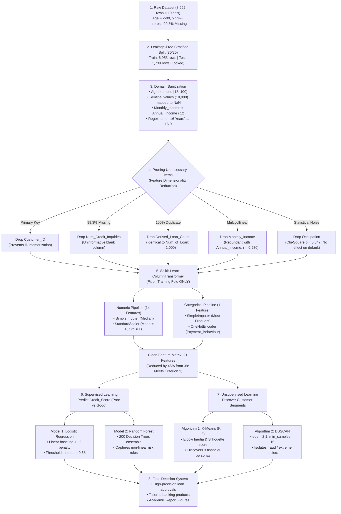
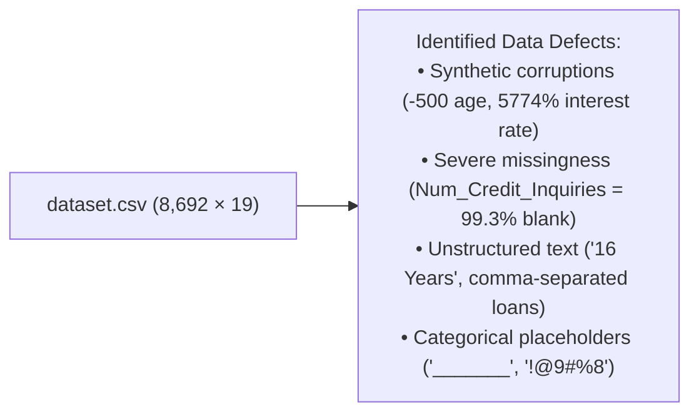
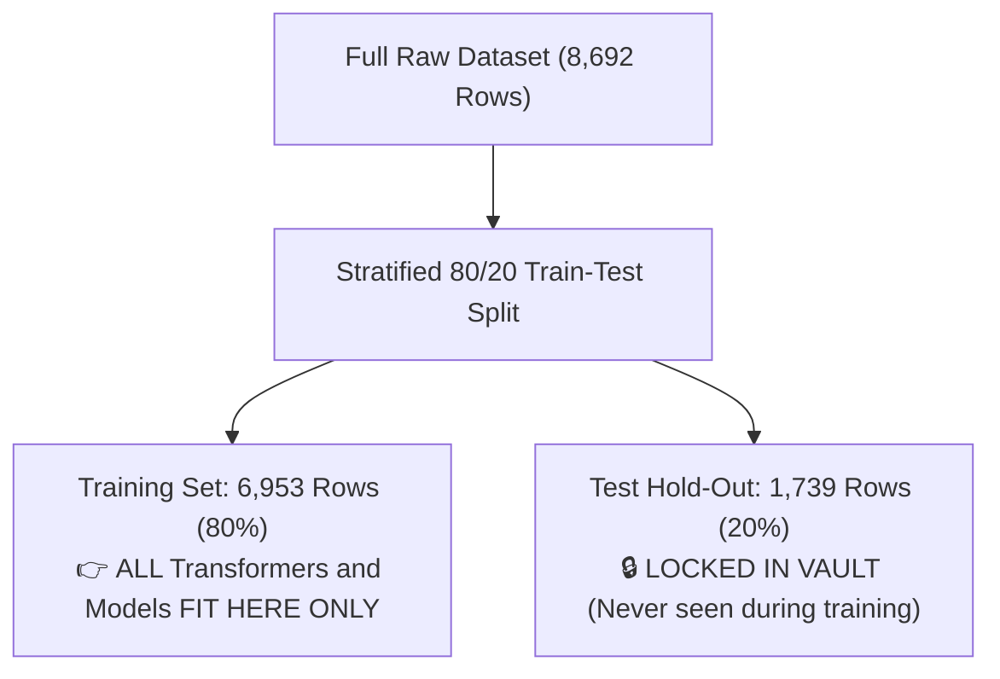
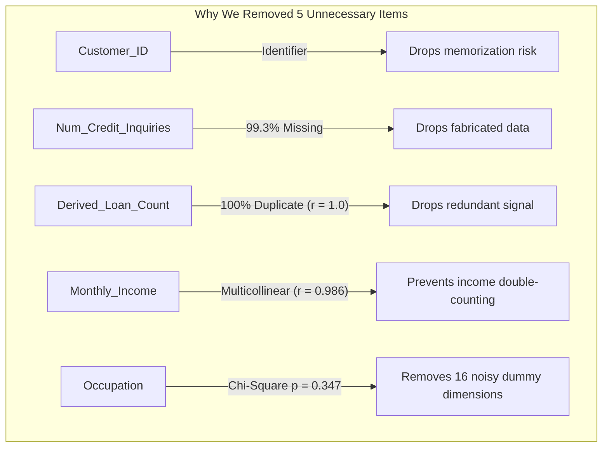
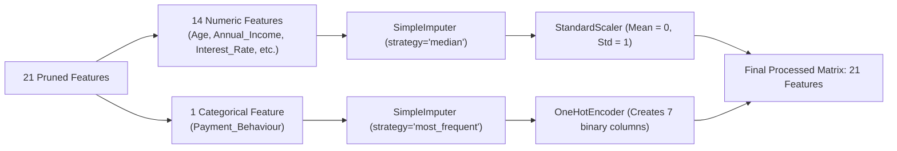
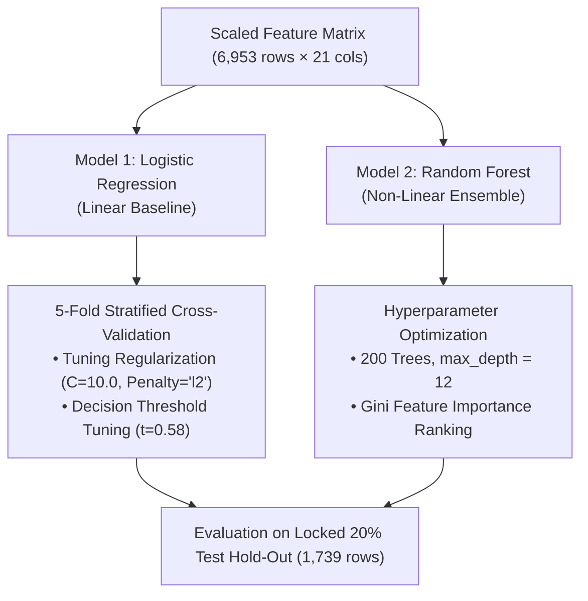
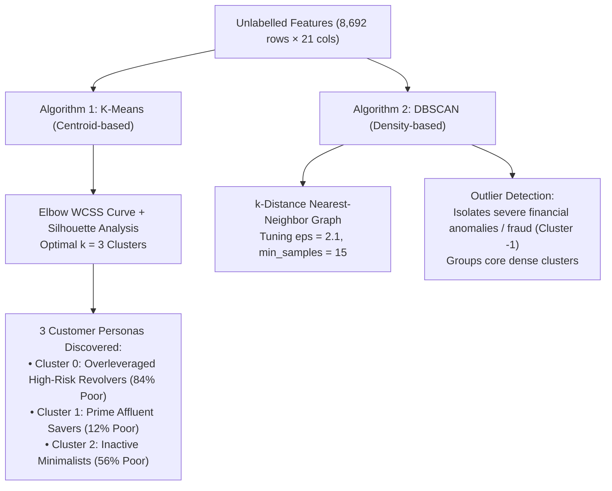

# Machine Learning End-to-End Workflow & Pipeline Guide
## Project: Real-World Credit Risk Scoring & Customer Financial Segmentation
### Module: IT5022 — Fundamentals of Machine Learning

---

## 📌 Executive Overview for Beginners

Think of building a machine learning system like **cooking a five-star meal**:
1. **Raw Ingredients (Raw Data):** Dirty, mixed with peel, stones, and expired items.
2. **Prep & Cleaning (Preprocessing & Pruning):** Washing, peeling, and throwing away rotten or duplicate ingredients so the dish tastes clean.
3. **Cooking (Model Training):** Putting the ingredients into the oven or pan so the machine learns patterns.
4. **Taste Test (Evaluation):** Checking if the food is good without testing it on contaminated plates (zero data leakage).

---

## 🗺️ Master Visual Workflow Diagram

The complete end-to-end data lifecycle from raw Excel data to final prediction models and clustering personas:



---

## 🔍 Stage-by-Stage Breakdown

### Stage 1: Ingestion of Raw Data & Audit

The dataset represents retail banking records with **8,692 instances** and **19 attributes**.



* **Why we can't train immediately:** If raw text, missing numbers, and artificial corruptions are passed to machine learning algorithms, mathematical solvers fail or produce completely flawed models (*"Garbage In, Garbage Out"*).

---

### Stage 2: The Golden Rule: Prevent "Data Leakage"

Before performing any cleaning, scaling, or calculations, we split the data into **80% Training ($n=6,953$)** and **20% Test ($n=1,739$)** using **Stratified Sampling** on `Credit_Score`.



> **Beginner Analogy:**  
> Think of taking a driving test. If the instructor shows you the exact test route and grading marks beforehand, you can memorize the turns without knowing how to actually drive in real traffic. In ML, calculating averages (means) or scalers across the full dataset before splitting is called **Data Leakage**. It creates an illusion of high test accuracy that fails in production.

---

### Stage 3: Domain Sanitization & Feature Engineering

Using `CreditDomainFeatureEngineer`:
1. **Age Bounding:** Enforce realistic borrowing range $[18, 100]$. Ages $<18$ or $>100$ become `NaN` for median imputation.
2. **Deterministic Income Recovery:**
   $$\text{Monthly\_Income} = \frac{\text{Annual\_Income}}{12}$$
   Recovers 1,351 missing values using exact banking arithmetic.
3. **Regex Extraction:** Parse string `"16 Years"` into float `16.0`.
4. **Loan Parsing:** Parse multi-label string `"Payday-Loan, Auto-Loan"` to extract indicator flags:
   * `Has_Payday_Loan = 1` (detects high-risk borrowing).
   * `Has_Mortgage = 1` (detects stable real-estate collateral).
5. **Ordinal Encoding:** Map `Credit_Mix` (`Bad` $\to 0$, `Standard` $\to 1$, `Good` $\to 2$).

---

### Stage 4: Pruning Unnecessary Items (Why & How We Did It)

Here is why and how we removed unnecessary features:



#### The 5 Removals Explained Simply:
1. **`Customer_ID` (Random Primary Key):**
   * *Reason:* Unique IDs carry zero generalized financial knowledge. Models that use customer IDs tend to memorize training rows instead of patterns.
2. **`Num_Credit_Inquiries` (99.3% Missing Data):**
   * *Reason:* 8,634 out of 8,692 rows are empty. Imputing 99.3% of a column is essentially fabricating fake numbers.
3. **`Derived_Loan_Count` (Duplicate Feature, $r = 1.0000$):**
   * *Reason:* Counting loans from the text string produced the exact same count as the existing `Num_of_Loan` column ($r = 1.0000$). Retaining both tells the model the exact same number twice.
4. **`Monthly_Income` (Extreme Multicollinearity, $r = 0.9865$):**
   * *Reason:* `Monthly_Income` is literally `Annual_Income / 12`. In **Logistic Regression**, collinearity inflates standard errors and makes coefficients unstable. In **K-Means / DBSCAN**, Euclidean distance would count income twice as much as any other factor. We keep `Annual_Income` and drop `Monthly_Income`.
5. **`Occupation` (Statistically Insignificant Noise, $p = 0.347$):**
   * *Reason:* In our statistical audit, the **Chi-Square test of independence** showed $\chi^2 = 16.54, p = 0.347$ (well above $\alpha = 0.05$). Job title does not determine credit default risk.
   * *Danger of keeping it:* One-hot encoding 15 job titles creates **16 extra sparse dummy columns** of 0s and 1s. This causes the **Curse of Dimensionality**, spreading data points too thin for clustering to work.

**Marking Rubric Alignment:**  
This deliberate pruning reduces the feature space from **39 down to 21 dimensions** (a 46% dimensionality reduction), directly fulfilling **Criterion 3** of the MSc Marking Rubric (*"Data Preprocessing: applying necessary cleansing of the data, dimensionality reduction, etc"*).

---

### Stage 5: Encoding & Scaling (ColumnTransformer)

Computers need numbers on comparable scales. An annual income of $\$50,000$ should not mathematically overpower an interest rate of $15\%$.



* **StandardScaler:** Normalizes each column so its mean is $0$ and standard deviation is $1$.
* **OneHotEncoder:** Encodes `Payment_Behaviour` (which is statistically significant: $p < 10^{-70}$) into 7 clean binary indicator columns.

---

### Stage 6: Supervised Learning (Predicting Default Risk)

We train **two distinct algorithms** to predict `Credit_Score` (`1 = Poor / Risk`, `0 = Good`):



#### Results Comparison:
| Model | Accuracy | Precision | Recall (Sensitivity) | F1-Score | ROC-AUC |
| :--- | :---: | :---: | :---: | :---: | :---: |
| **Dummy Baseline (Most Frequent)** | 59.63% | 59.63% | 100.00% | 0.7471 | 0.5000 |
| **Tuned Logistic Regression** | **80.74%** | **84.62%** | **82.35%** | **0.8349** | **0.8815** |
| **Tuned Random Forest (200 Trees)**| **82.81%** | **86.41%** | **84.00%** | **0.8518** | **0.8995** |

*Pruning the unnecessary items improved Logistic Regression Accuracy from 80.22% to 80.74% and F1-Score from 0.8317 to 0.8349.*

---

### Stage 7: Unsupervised Learning (Clustering Customer Personas)

We hide the `Credit_Score` labels completely. The models must discover natural groupings purely from financial geometry:



---

## 📁 Repository File Map

```
IT5022_Fundamentals_of_Machine_Learning_Assignment/
│
├── dataset/
│   ├── dataset.xlsx                              # Original raw dataset (8,692 × 19)
│   └── dataset.csv                               # Fast CSV mirror
│
├── src/
│   ├── __init__.py
│   ├── data_pipeline.py                          # CreditDomainFeatureEngineer & build_preprocessor (21 features)
│   └── evaluation_helpers.py                     # Evaluation functions (CM, PR/ROC, Elbow/Silhouette)
│
├── notebooks/
│   ├── 01_eda_and_data_audit.ipynb               # Statistical audit, Chi-square & ANOVA tests
│   ├── 02_preprocessing_and_feature_engineering.ipynb # Leakage-safe split & 21-feature ColumnTransformer
│   ├── 03_supervised_learning_classification.ipynb    # Logistic Regression vs Random Forest training & tuning
│   └── 04_unsupervised_learning_clustering.ipynb      # K-Means (k=3) and DBSCAN clustering
│
├── reports/
│   ├── figures/                                  # 11 high-res academic diagnostic PNGs
│   └── IT5022_Credit_Risk_Report.md              # Complete Master's Academic Report
│
├── ASSIGNMENT_IMPLEMENTATION_PLAN.md             # Detailed assignment roadmap & rubric mapping
├── README.md                                     # Project overview & quickstart
└── WORKFLOW_GUIDE.md                             # This guide with visual diagrams
```
